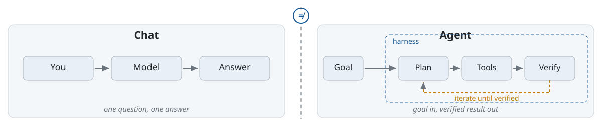
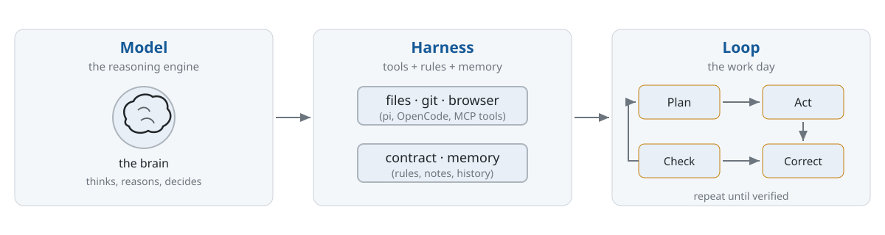
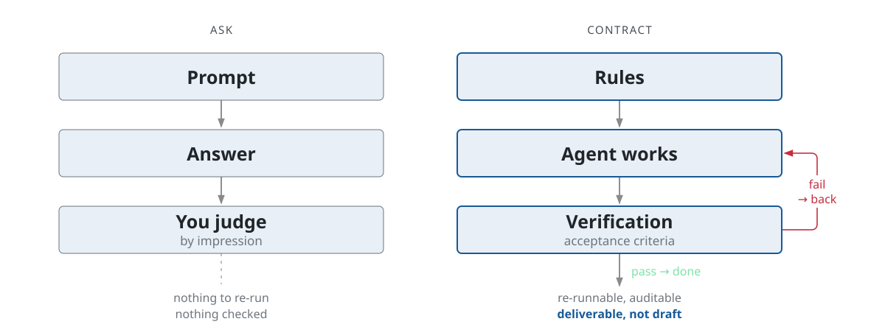
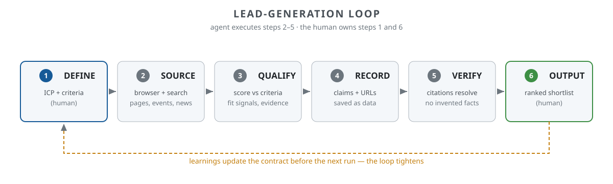

<!-- _class: lead -->

# Agentic AI for Lead Generation

## Partner companies for the Marketing Chair

Tobias Weiß · Guest Lecture · Marketing Chair

Thursday, 22 October 2026 · 15:15–16:00
within "Advanced Issues in Marketing and Sales" (Prof. Haas)

45 minutes · BWL Master students · WS 2026/27 edition

<!-- notes:
⏱ ~45 s · READ ALOUD

Good afternoon — thank you for having me. This session is about
agentic AI: what it is, and how to run it so its work is
trustworthy. Everything today maps onto one real task — helping
this chair find and qualify B2B partner companies. The shortlist
the agent produces is evidence for our Bachelor course Sales
Strategy and Execution next summer. Nothing here is an exercise.
It is the start of a deliverable. Let's begin.
-->

---

## Why this session exists

- The chair partners with companies: funding, data, cases
- Finding + qualifying partners is manual, slow, unscalable
- Agentic AI can research, score and rank prospects
- **Demo output = evidence for "Sales Strategy and Execution" (SS 2027)**

> Nobody wins from another lecture about chatbots.

<!-- notes:
⏱ ~45 s · READ ALOUD

[If preceding talker, bridge first:] You just heard about modern
marketing and sales in a digital world — agentic AI is the tooling
that puts exactly that into practice.

The chair partners with companies — for funding, for data, for
teaching cases. Finding and qualifying those partners is manual
work: slow, and it doesn't scale. Agentic AI can research
companies, score them, and rank them. And be clear: nobody needs
another lecture about chatbots. What you need is to recognise —
and judge — an agentic workflow, and to read the contract that
drives it. The demo produces a ranked list of partners, every claim
with a source. That list is the dataset the Bachelor course builds
on next year.
[jot: the "ranked list" is the handoff artefact — the
"output as input" promise. Protect it; it returns on slides 17/19.]
-->

---

## What you will be able to do

| By the end… | You can… |
|---|---|
| **Understand** | Explain what "agentic" means, and why it is not a chatbot |
| **Operate** | Read how a harness (pi) gives an AI tools, rules and a task |
| **Assess** | Judge an agentic output: checked? citable? repeatable? |
| **Apply** | Run the exercise yourself: ingest + rate leads for the chair (repo → rubric → validator) |
| **Context** | Say which context an agent can't know — and why that keeps you in charge |

> Model = brain. Harness = hands. Workflow = muscles. **Context = memory — the part only you can supply.**

<!-- notes:
⏱ ~30 s · READ ALOUD

Here's the promise of the next forty-five minutes, in four rows.
You'll be able to explain what agentic means — and why it is not
a clever chatbot. You'll be able to read how a harness gives an AI
tools, rules, and a task. You'll be able to judge an agentic output
— checked? citable? repeatable? And you'll run the loop yourself: repo, rubric, validator —
you'll ingest and rate leads for the chair before the course ends. One headline before we
start: model is the brain, harness is the hands, workflow is the
muscles — and context is the memory. That part is yours.
[Not read — colour:] Row 5 is the thread of the whole talk:
intelligence is distributed — generation (model), execution
(harness), context (you).
-->

---

<!-- _class: smaller -->

## Roadmap — 35 min + 10 min Q&A

| Block | Content | Time |
|---|---|---|
| 1 · Foundations | agentic ≠ chat · model · harness · loop | ~8 min |
| 2 · Method | contracts · the lead-gen loop · rating formulas · evidence | ~9 min |
| 3 · Walkthrough | live demo: repo → agent → validator | ~13 min |
| 4 · Reflection | providers · take-aways · resources | ~5 min |
| 5 · Q&A | your questions · discussion | 10 min |

> The walkthrough is the heart — theory is fuel for it. **10 minutes are reserved for your questions.**

<!-- notes:
⏱ ~15 s · READ ALOUD

The map for the next thirty-five minutes: foundations first, then
the method, then the live walkthrough — the heart — and a short
reflection at the end. Ten minutes are reserved for your questions.
If one comes to you mid-talk, write it down — we'll get to it.
[Not read:] The notes sum to ~32 min; the gap to 35 is deliberate
buffer for transitions and demo hiccups. Q&A is fixed at 10 min —
bank questions with "hold that for Q&A".
-->

---

## Agentic ≠ chat



> "Agentic" is a working environment — not a better chat.

<!-- notes:
⏱ ~2.5 min · READ ALOUD

Let's clear up the most common confusion first. On the left: chat.
Question in, answer out. No tools, no files, no actions — a
conversation. On the right: an agent — a goal, a plan, tools,
verification, running inside a harness that grants it access to the
world: a browser, files, APIs. The amber loop in the middle is
where the work happens. The key point: agentic is not a smarter
ChatGPT. It is a difference in kind, not in size. The model can
touch the world, and it can check its own work. Keep this image —
it's the whole lecture in one picture.
-->

---

## The parts: model · harness · loop



**Harnesses (2026):** pi, OpenCode, Claude Code — same model, different results. The harness decides.

<!-- notes:
⏱ ~2.5 min · READ ALOUD

Three parts. The model — the brain. The harness — the piece this
lecture adds: an executable environment, permissions, memory — the
hands and the workspace. And the loop — what makes it agentic: it
plans, acts, checks, corrects itself. Two asides. First: a fourth
ingredient is deliberately not on this diagram — context, the
criteria and judgement the loop cannot invent for itself. That's
yours, and it comes back in two slides. Second: pi is the harness
you see in the demo. I use it mainly for its small memory footprint.
OpenCode and Claude Code are solid alternatives. Same model,
different results — the harness decides.
[Not read:] If asked why pi — small memory footprint; OpenCode and
Claude Code are solid alternatives.
-->

---

<!-- _class: smaller -->

## Why now — the evidence inside the research corpus

The chair's open corpus (marketing-research, public on GitHub): **14,052 papers — 8,706 published in 2026 alone**

| Signal | Count |
|---|---|
| Papers mentioning **agentic AI** | 110 |
| Papers on **lead generation** | 32 |
| **Both** (agentic × lead-gen) | **1** |
| Papers on **context-aware** marketing | 23 |

> A targeted search round turned the intersection from **0 to 1** (JBR, 2026) — the field just opened. Claim the gap while it's a gap.

<!-- notes:
⏱ ~1.5 min · READ ALOUD

Why now? The evidence — from this chair's own open research corpus,
public on GitHub. Fourteen thousand and fifty-two marketing papers.
Eight thousand seven hundred and six published in 2026 alone. One
hundred and ten papers mention agentic AI — ninety-eight of them
from this year. Thirty-two are about lead generation. Now the
intersection — papers that do both? Until a few weeks ago, zero.
We ran a targeted search round before this lecture: zero became
one. The first paper connecting agentic AI to lead generation
landed in the Journal of Business Research at the start of this
year. One paper. That is the signal, not the wall: the field just
opened, and the first position in it is still free.
[Not read — honesty note if probed:] Counts are keyword search over
title/abstract of our own corpus (docs/papers.json, 14,052 papers,
regenerated 19 Oct 2026). Intersection went 0→1 when the gap round
added 8 verifiable papers (JBR agentic-sales 2026; SSRN telemarketing
field study 2026; SSRN MCP-orchestrated B2B prospecting 2026;
GTM-Bench 2026; arXiv 2503.23303 / 2509.04871 / 2510.21713 /
2511.01181). The corpus gap was real but closing — never claim an
empty field, claim the lead.
-->

---

## How to talk to the machine: prompts vs contracts



> Prompt = asks a chat · Contract = runs an agent · **Context = what the machine can't know**

<!-- notes:
⏱ ~2 min · READ ALOUD

This is the central mental model of the lecture. A prompt is how
you ask a chat: a question, in one go. A contract is how you run an
agent: it lives in the repository, it's versioned, it says what
'done' means. And the third piece: context. The contract is a
container for context — the chair's criteria, the sources we trust,
our judgement, the history of partnerships. Without it, the agent
is a brilliant generalist with no idea what 'good' means here. A
prompt turns an idea-generator into a conversation. A contract
turns it into a reproducible research pipeline. And in this
project the contract is not a document the agent might ignore — it
is the repository itself: schema, rubric, executable validator.
You'll see it in ten minutes.
-->

---

## A lead-generation loop as an agentic workflow



> Six steps — the agent executes 2–5, you own definition and evaluation. **Those two boxes are where context lives.**

<!-- notes:
⏱ ~3 min · READ ALOUD

Let's make it concrete — a lead-generation loop as an agentic
workflow. Read it left to right. [point to each box as you say it]
DEFINE — you: the blue box. What does a good partner look like for
this chair? SOURCE — where do we hunt? QUALIFY — does this company
fit? RECORD — capture every claim with its source. VERIFY — check
those sources say what we think they say. OUTPUT — a ranked list,
judged by a human. The agent runs the middle four steps. You own
the first and the last — and you know why from the slide before:
those two boxes are where the context lives. The amber line along
the bottom: what you learn on a run feeds back to tighten the
contract for the next run. The agent stays inside the loop. The
human stays in charge.
[Not read:] DEFINE injects context (criteria, sector, guard rails);
EVALUATE judges with context (the three questions). Next slide makes
DEFINE concrete — the sector choice, still human work.
-->

---

<!-- _class: smaller -->

## Define the hunt: scoring the sector

Lead generation starts with a **human** decision: *which sector do we hunt?*

| Criterion (1–5) | Mech. & plant engineering | Optics / photonics | Grocery retail |
|---|---|---|---|
| Chair research fit — sales management | 5 | 5 | 2 |
| Course fit — "Sales Strategy and Execution" | 5 | 5 | 2 |
| Regional employers (Mittelhessen) | 5 | 5 | 3 |
| Lead-gen relevance — B2B, long cycles | 5 | 4 | 2 |
| Demo data availability | 4 | 4 | 5 |
| **Total** | **24** | **23** | **14** |

> Hard guard: sector is out if chair fit < 4 **or** lead-gen relevance < 4 — grocery retail (our first default) fails. **Decision: German mechanical & plant engineering.**

<!-- notes:
⏱ ~45 s · READ ALOUD

Before the agent does anything, a human decides where to hunt.
Look at the table: five criteria, scored one to five, plus one hard
guard. Our first default — grocery retail — fails the guard: lead
generation there is a consumer, demand-gen game, not a
sales-strategy one. Optics came close. Mechanical and plant
engineering wins on every axis. That's the sector you'll see in the
demo. And notice what just happened: the AI did not choose the
sector. We did. Choosing target segments is a core sales-strategy
decision — one we can teach in the Bachelor course.
[Not read:] This is the DEFINE box made concrete; guards the claim
the walkthrough is human-steered, not agent-chosen.
-->

---

<!-- _class: smaller -->

## Rate a lead: pick a formula — before the agent runs

| Formula | Rule | Trade-off |
|---|---|---|
| Weighted sum | `L = Σ wᵢ·sᵢ` · w: fit .35 · region .25 · size .15 · evidence .15 · timing .10 | transparent · **compensatory**: a 5 on fit can hide a 0 on evidence |
| Geometric mean | `L = Π sᵢ^wᵢ` | **non-compensatory**: one zero sinks the lead · harsh to defend |
| **Gated weighted sum** ✓ | gates first — B2B · region reachable · ≥ 1 verified source — then weighted sum | matches the chair's decision · thresholds = judgement calls |

Example (each criterion 0–5): fit 5 · region 3 · size 4 · evidence 4 · timing 2 → `L = 3.90`

> Weights live in the repo (`students/leads.yaml`, `rubric:`) — **published context, not vibes**. Change them — in a PR, with reasons.

<!-- notes:
⏱ ~2 min · READ ALOUD

Before the agent scores anything, we decide how scoring works.
Five criteria, each nought to five: fit — chair research fit;
region — Mittelhessen reachability; size — at least a thousand
employees; evidence — independent sources; timing — live signals
like expansion or sales hiring. Three candidate formulas. The
weighted sum: transparent — but compensatory. A five on fit can
hide a zero on evidence. The geometric mean: one zero sinks the
whole lead — harsh, and hard to explain to a dean. Our choice:
gates first — B2B, region reachable, at least one verified source
— then the weighted sum on the survivors. Exactly like the sector
guard two slides ago. Worked example: three point nine. And the
weights are not vibes — they are published in the repository, in
the same file you will edit. Disagree? Change them — in a pull
request, with reasons. That is what published context means.
-->

---

## Now: a live walkthrough

Task: ingest **2 leads** into the chair's repo — `students/leads.yaml` — with:

- scores per criterion + the weighted sum, gates applied, ranked
- named source URL per claim (citable, verifiable)
- `python3 students/validate_leads.py` passing before anything counts

I run this live in a harness — in the same repo you will work in.
No fallback video: this exact exercise was **tested agentically**, end to end.

<!-- notes:
⏱ ~30 s · READ ALOUD

The live walkthrough. Task: ingest two leads into the chair's
repository — the same file, schema and validator you will use
yourself. Every claim with a source URL, scores per criterion,
gates first, then the weighted sum. And no fallback video: if
something breaks, I fix it live — that is the loop working. The
approach is trustworthy because it was tested agentically
beforehand — same task, same prompt, several timed runs. Let's go.
-->

---

<!-- _class: smaller -->

## Walkthrough · Step 1 — The repo is the contract

```text
marketing-research/               github.com/tobias-weiss-ai-xr/marketing-research
├─ papers.yaml                    14,052 papers — single source of truth
├─ config/taxonomy.yaml           categories + discovery queries
├─ scripts/validate_papers.py     the contract, executable
├─ students/leads.yaml            your starting point: schema + rubric
├─ students/validate_leads.py     same pattern: validate before commit
└─ README.md · statistics.json    auto-generated — never hand-edited
```

> No prose rules file the agent can ignore: **structure + validators + one source of truth.**

<!-- notes:
⏱ ~2 min · READ ALOUD

Step one: the contract. Earlier I said contracts beat prompts —
here is what that means in practice. It is not a document the agent
reads at start and may ignore. It is the repository itself. One
source of truth: papers.yaml, fourteen thousand and fifty-two
papers. Everything downstream is generated, never hand-edited.
Every change passes an executable validator before it is committed.
And your exercise lives in the same pattern: students/leads.yaml —
schema, rubric, weights — and its own validator. Done does not mean
"looks finished". Done means the validator passes. One
critical-literacy point before we go on: every source in this repo
is self-reported by companies. A URL proves a claim exists; it does
not prove the claim is true. So the standing question today: whose
evidence is this?
[Not read:] The earlier approach — an AGENTS.md rules file — kept
getting ignored and drifting; structure plus executable validation
is what survived contact with real runs.
-->

---

<!-- _class: smaller -->

## Walkthrough · Step 2 — The agent at work

Watch the six-step loop run live:

- **only watch** — no magic, every tick is visible in the terminal
- agent reads the **repo** (schema + rubric), then **opens the browser** (MCP) — real company pages
- writes leads into `students/leads.yaml` → runs the **validator** → fixes what fails
- **iterates**: pause, correct, re-check — that is the loop

> Nothing happens off-screen — the loop is fully visible.

<!-- notes:
⏱ ~8 min live action — spoken play-by-play, in this order:

[agent starts] "I'm introducing the agent the way I'd introduce a
new colleague: here's the repo — schema, rubric, validator.
Here's the task. Show me your plan first."

[it plans] "Watch the plan — it maps one-to-one onto the six boxes
from the pipeline slide."

[it opens the browser] "There it is — it can touch the world; that's
what agentic means. It's reading the companies' own pages. Right
now it is absorbing our context — the criteria it could not invent
for itself."

[it scores] "It scores each lead against the rubric — fit signal,
one sentence, source alongside."

[on a mistake — pause, then:] "Hold on. It over-claimed. Stop.
Which URL says that?" [let it correct itself] "That
pause-and-correct is the loop in action."

[it runs the validator] "It re-checks its own citations and the
score math — the validator checks both. That's step five: verify."

[final table] "There's the shortlist — ranked, cited, validated.
Let's judge it with the three questions."
[Not read:] Steps: (1) open browser via MCP, search prospects;
(2) read real pages, extract fit signals; (3) score vs rubric;
(4) write students/leads.yaml entries with URLs; (5) run
validate_leads.py, fix failures; (6) ranked table. Speed beats
completeness — cut lead two if running long. Demo runs on real
public data via cloud API — never paste private/customer data.
Tested beforehand: ≥2 timed agentic runs of this exact exercise
(demo/test-protocol.md). If it breaks live: debug on screen and
name it — a fixed failure is the lesson. No recording, no
fallback video.
-->

---

## Walkthrough · Step 3 — The three questions

1. **Checked?** Did the agent verify its output, not just generate it?
2. **Citable?** Does every claim have a URL that resolves — and actually supports it?
3. **Repeatable?** Same repo, same rubric, same validator → a result you can re-run and audit?

*The 1–5 scores are a transparent heuristic — each criterion with evidence — not a measurement.*

> All three guard one thing: **context** — invented context (Checked) · untraceable context (Citable) · lost context (Repeatable).

> The final slide of the walkthrough: apply them to the live result.

<!-- notes:
⏱ ~2 min · READ ALOUD

The last step of the walkthrough: judge the output with three
questions. Checked — did the agent verify its output, or just
generate it? Citable — does every claim carry a URL that resolves
and supports the sentence? Repeatable — re-run the same repo, the
same rubric, the same validator: a result you can audit. All three
guard context.
Checked guards against invented context. Citable guards against
untraceable context. Repeatable guards against lost context. If the
output passes, it's a deliverable. If not, it's a draft. Same
discipline as verifying a prospect's claims before you sign.
Verify before you trust.
[Not read:] Repeatability is process-level, not byte-identical
output — models are stochastic, the method is re-runnable. Sales
connection: you verify a prospect's claims before signing.
-->

---

<!-- _class: lead -->

## Your turn: ingest + rate leads for the chair

1. **Fork & clone** — the repo is public; open `students/`
2. **Ingest 3 leads** — real B2B companies, every claim with a URL
3. **Score & rank** — gates first, then the published formula
4. **Validate & submit** — validator passes → pull request

> Best submissions join the chair's real shortlist — "Sales Strategy and Execution", SS 2027.

<!-- notes:
⏱ ~1.5 min · READ ALOUD

Now it's your turn. The repo is public — fork it, clone it, open
the students folder. The brief, the schema, the rubric, the
validator: all there. Your task: ingest three leads — real
companies that could partner with this chair. Score them with the
published formula: gates first, then the weighted sum. Run the
validator; if it passes, open a pull request. The chair reviews
submissions like papers. And the best ones join the real shortlist
for the Bachelor course next summer. Everything you saw today,
you now run yourself.
[Not read:] Replaces the old 'what you just saw' recap — that
content lives in the take-aways now. This slide is an action, not
a summary.
-->

---

## What the chair gets out of it

- A reproducible partner-sourcing method (not a one-off search)
- A ranked, sourced shortlist — fed by the course's best submissions
- Students who can run agentic workflows (a real skill for the CV)
- Evidence base for the **Bachelor course "Sales Strategy and Execution"** (SS 2027)

> The lecture is not the output. The shortlist is.

<!-- notes:
⏱ ~1.5 min · READ ALOUD

What does the chair get out of this? Four things. A reproducible
partner-sourcing method — not a one-off search. A ranked, sourced
shortlist — and it grows with every student submission. Students who can run agentic
workflows — a real CV skill; that's what companies hire for now.
And an evidence base for the Bachelor course Sales Strategy and
Execution next summer. One note: everything here is open and
reusable — you can take this method into internships and theses.
The lecture is not the output. The shortlist is.
-->

---

<!-- _class: smaller -->

## Key AI providers — what you can use as a student

| Provider / offer | What you get | Where |
|---|---|---|
| **JLU HRZ API-Service** ⭐ | LLMs for all JLU members: free local Qwen models (256K–1M ctx) + commercial, works with OpenCode / Claude Code | [uni-giessen.de → HRZ → KI → API-Service](https://www.uni-giessen.de/de/fbz/svc/hrz/svc/services/ki/api-service) · access via **ki@uni-giessen.de** |
| **Google AI student plan** | 1 year Google AI **Plus** free · Gemini, higher limits, 400 GB | [one.google.com/ai-student](https://one.google.com/ai-student?g1_landing_page=75) — verify via SheerID (student status) |
| **OpenRouter** | one API key → many models (OpenAI, Anthropic, Google, open) · free models + pay-as-you-go | [openrouter.ai](https://openrouter.ai) |
| **Harnesses** | the tools from today's demo — **OpenCode**, pi — work with any key above | [opencode.ai](https://opencode.ai) · [pi.dev](https://pi.dev) |
| **Local models (Ollama)** | free, run on your own laptop, no account, private | [ollama.com](https://ollama.com) |

> Start with **HRZ API** (free for JLU) · Google deal expires **Dec 31, 2026** · campus DNS can't resolve `opencode.ai`? → resolver `1.1.1.1` / `8.8.8.8` or hosts entry `172.65.90.20 opencode.ai` — how-to: one-pager

<!-- notes:
⏱ ~1.25 min · READ ALOUD

What can you use as a student, starting tomorrow? Best option
first: the JLU HRZ API-Service. Free LLMs for every university
member — locally hosted Qwen models with up to a million tokens of
context, plus commercial models. Access by emailing
ki@uni-giessen.de; works with OpenCode out of the box. Google gives
students a year of Google AI Plus free — verify with your
university email by the end of December. OpenRouter: one key, many
models, free tiers included. Ollama runs locally — free and
private. And the harnesses, OpenCode and pi, are what you've seen
today. If you take one thing from this slide: start with HRZ.
One practical note on the network: if the campus Wi-Fi cannot
resolve opencode.ai, the fix — a public resolver or a hosts entry —
is in the HRZ one-pager. Thirty seconds of setup, then move on.
[Not read — DNS fix if opencode.ai does not resolve (hall Wi-Fi):]
Diagnose: `nslookup opencode.ai` fails while other pages load.
Fix A — resolver: set DNS on the Wi-Fi adapter to 1.1.1.1 +
8.8.8.8 (Windows: adapter → IPv4 → DNS; macOS: Network → Details →
DNS; Linux: NetworkManager → IPv4 → DNS); reconnect, retry.
Fix B — hosts entry (admin): resolve fresh via
`dig +short opencode.ai @1.1.1.1`, then append `<IP> opencode.ai`
to /etc/hosts (Linux/macOS) or C:\Windows\System32\drivers\etc\hosts
(Windows). Verified 19 Oct 2026: 172.65.90.20 (Cloudflare anycast,
.20–.23 all work) — re-verify at prep time, IPs can change.
Still failing → it is the firewall, not DNS → phone hotspot for
the demo machine; do not fight a deliberate campus block.
[Not read — for questions:] Google deal redeem by Dec 31 2026,
SheerID verification; OpenCode via LiteLLM provider block
(baseURL api.hrz.uni-giessen.de) or Claude Code via
ANTHROPIC_BASE_URL.
-->

---

## Take-aways

1. Agentic = working environment, not a chatbot
2. Harness = model + tools + rules = accountable AI work
3. The repo is the contract: schema, rubric, validator — "done" is executable
4. Verify, cite, repeat — the three questions
5. **Context beats compute — the right context contract beats a bigger model**

> Next summer semester: the chair decides what this evidence feeds into
> the Bachelor course "Sales Strategy and Execution".

<!-- notes:
⏱ ~1 min · READ ALOUD

Five lines to take home. Agentic is a working environment, not a
chatbot. A harness is a model plus tools plus rules — that's what
makes AI work accountable. The repo is the contract — schema,
rubric, validator. Done is not 'looks finished'; done is the
validator passing. Verify, cite, repeat — the three questions. And the one
to remember: context beats compute. A small model with your
context beats a big model with none. Next summer, this shortlist
becomes the Bachelor course's input — the chair decides what it
feeds.
[Not read:] Take-away 5 is the portable one-liner; it reframes the
lecture beyond today's demo.
-->

---

## Resources

- **JLU HRZ API-Service** (free LLMs for JLU members) — [uni-giessen.de → HRZ → KI → API-Service](https://www.uni-giessen.de/de/fbz/svc/hrz/svc/services/ki/api-service) · [model overview](https://api.hrz.uni-giessen.de/ui/model_hub_table/)
- **HRZ access one-pager** (student quick start, 1 page) — [`hrz-access-one-pager.md`](hrz-access-one-pager.md)
- **pi** — [pi.dev](https://pi.dev) · docs: [pi.dev/docs](https://pi.dev/docs) · **OpenCode** — [opencode.ai](https://opencode.ai) · **OpenRouter** (one key, many models) — [openrouter.ai](https://openrouter.ai)
- **Google AI student plan** — [one.google.com/ai-student](https://one.google.com/ai-student?g1_landing_page=75) (1 year free for students)
- **marketing-research** (chair corpus, public) — [github.com/tobias-weiss-ai-xr/marketing-research](https://github.com/tobias-weiss-ai-xr/marketing-research) → start at **`students/`** (exercise brief · rubric · validator)
- **skeleton-research** (forkable corpus skeleton) — [github.com/tobias-weiss-ai-xr/skeleton-research](https://github.com/tobias-weiss-ai-xr/skeleton-research)
- **This deck** — [`lecture/`](.) in this corpus repo (English, 45 min)

<!-- notes:
⏱ ~30 s · OPTIONAL read — the list stays up on screen either way.

"Everything on this slide is public and reusable — the links are in
the deck. Two are worth starting with: the HRZ API-Service, and the
research corpus that today's evidence came from. Fork it — it's a
skeleton you can grow into your own corpus."

[If you only say one sentence:] "All links are in the deck — the
corpus and the one-pager are where I'd start."
[Not read:] Lead with HRZ API-Service (free, university-provided).
Google link repeats the providers slide so it survives sharing.
marketing-research = evidence base of the "why now" slides;
skeleton-research = forkable starter for a student's own curated
corpus; hrz-access-one-pager.md = student quick start.
-->

---

<!-- _class: lead -->

# Thank you!

## Questions?

Tobias Weiß · guest lecture · Marketing Chair

Agentic AI for Lead Generation · 22 Oct 2026 · 45 min

<!-- notes:
⏱ 10 min Q&A — closing words first, then moderation.

[Closing, ~15 s · READ ALOUD:] "Thank you for listening — and for
the questions you've banked. Let's hear them, one at a time."

[Each answer — keep it short, one idea, then ask the next person.]
Prepared answers you're likely to reach for:

- Model choice — the demo runs on **big pickle**; the harness is
  model-agnostic — pi switches model with Ctrl+L. Cost is why we
  pick cheap models with tight contracts, not size.
- "Is this just a fancy search engine?" — search returns matches;
  this returns judgements, because the contract carries the chair's
  context and every judgement is source-traceable. Context is the
difference — and it's yours, not the model's.
- "Is the output reproducible?" — same contract, same method:
  auditable, re-runnable; never promised byte-identical, models are
  stochastic.
- Data privacy — local models (Ollama, HRZ Qwen) if it matters;
  today's demo is public data only.
- "What does qualified mean?" — defined in the rubric
  (`students/leads.yaml`): fit, region, size, evidence, timing, each
  0–5; gates first, then the published weighted sum.
- "What if the demo breaks?" — we debug it live; the approach was
  tested agentically beforehand (timed runs of the exact exercise).
- Trying it themselves — resources slide; start with HRZ API and the
  `students/` folder in the repo.

[Hard stop at 16:00 — the course's Übung starts in this room right
after; the ten minutes belong to the students, never overrun.]
-->
